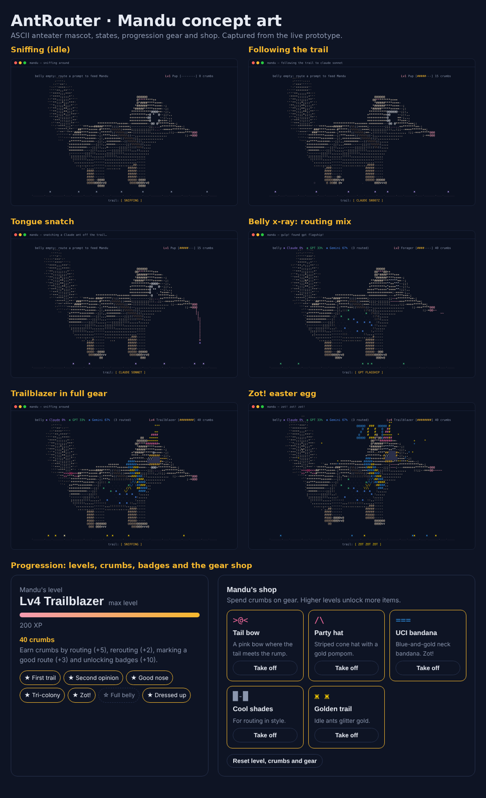

# AntRouter 🐜

**You bring the prompt. Mandu finds the trail.**

AntRouter is a model router for LLMs wrapped in a cozy companion game. You type the prompt you'd normally give an AI, and Mandu, an ASCII anteater, picks the best model among Claude, GPT and Gemini, shows you why, and learns from your corrections. Every prompt he routes becomes an ant in his see-through belly, so you can see where your prompts actually go.

Built as a course prototype at UC Irvine.



## Try it

- **Original prototype (single file):**  https://ethanethernet.github.io/antrouter/
- **Run locally:** double-click `index.html`. No build step, no install, no API key.
- **Chrome extension:** load this folder as an unpacked extension and open Mandu from the toolbar. Step-by-step instructions are on the website at [ethanethernet.github.io/antrouter/extension.html](https://ethanethernet.github.io/antrouter/extension.html) and in [Using the Chrome extension](#using-the-chrome-extension) below.
- **Watch the loop:** press **▶ 1-minute tour** on the website, or play [`media/antrouter-1min-tour.mp4`](media/antrouter-1min-tour.mp4).

## Using the Chrome extension

The extension is the same app as the website, shrunk into a popup so Mandu is one click away while you work in Claude, ChatGPT or Gemini. It isn't on the Chrome Web Store yet, so you load it yourself. That takes about a minute.

### Install it

1. Get the code: clone this repo, or download it as a ZIP from GitHub (**Code → Download ZIP**) and unzip it.
2. In Chrome, go to `chrome://extensions`.
3. Turn on **Developer mode** (top right).
4. Click **Load unpacked** and choose the folder that contains `manifest.json` (the repo's top folder).
5. AntRouter appears in your extensions list. Click the puzzle-piece icon in Chrome's toolbar and pin **AntRouter** so the anteater icon stays visible.

Want a smaller copy with only the files the extension needs? Run `powershell -ExecutionPolicy Bypass -File tools/package-extension.ps1` from the repo folder. It builds `dist/antrouter-extension/` (load that folder instead) and `dist/antrouter-extension.zip`.

### Start it

Click the AntRouter icon in the toolbar. Mandu opens in a popup right away. There's no title screen in the extension, so you can route a prompt within seconds. The popup closes when you click anywhere outside it. Your progress is saved, so it picks up where you left off next time.

### Find your way around the popup

| Where | What it does |
|---|---|
| **Top bar** | Your level and crumbs, **Settings**, **End session** and the Light/Dark/System theme switch. |
| **Prompt box** | Choose the app you're working in (**Any app**, **Claude**, **ChatGPT**, **Gemini**), type a prompt or tap a sample (the samples scroll sideways), then press **Route prompt** or **Ctrl+Enter** (**⌘+Enter** on a Mac). |
| **Left side: Mandu** | Watch him follow the trail and swallow an ant. Under him: **Zot!**, **Pet Mandu**, **Nap** and **Wake up**. The window lights hide him (red), minimize him (yellow) or expand him (green). |
| **Right side: tabs** | **Route** shows the pick, how sure Mandu is, the reroute chips, **Good route**, **Second opinion** and **Open in…**. **Trails** shows what he has learned, **Progress** your level, unlocks, badges and quests, **Shop** gear, and **About** a glossary of Mandu's words. |

Keyboard: **Tab** moves between controls, and the arrow keys move between tabs.

**Open in Claude** and **Open in ChatGPT** open a new tab with your prompt already filled in. Gemini can't take a prompt through a link, so **Open in Gemini** copies it for you to paste.

### How the extension differs from the website

- **No title screen, tour or core-loop strip.** These are left out to fit the popup. Use the website to watch the tour.
- **Its own save.** Chrome keeps the extension's storage separate from the website's. To bring your level across, open **Settings → Move your save** on one, press **Copy my save code**, then paste it into **Settings** on the other and press **Load this code**.
- **Same game otherwise.** Levels, unlocks, crumbs, quests, Calm mode and sound all work the same.

### Update it

After you pull new code (or download a fresh ZIP), go to `chrome://extensions` and click the circular **reload** arrow on the AntRouter card. Your save is kept.

### If something looks wrong

- **The icon is missing:** pin it from the puzzle-piece menu.
- **"Manifest file is missing or unreadable":** you picked the wrong folder. Choose the one that has `manifest.json` directly inside it.
- **Music doesn't play:** turn it on in **Settings** (it's off by default). If you used the packaging script, re-run it so `Carefree.mp3` is included.

## What's in the prototype

| Mechanic | What happens |
|---|---|
| **Route** | Type or pick a prompt. A keyword router reads task type and difficulty and scores 7 models (Claude Opus/Sonnet/Haiku, GPT flagship/mini, Gemini Pro/Flash). |
| **Tongue snatch + belly** | Mandu follows the trail, snatches an ant in the model's color and swallows it. The belly x-ray shows your Claude / GPT / Gemini split. |
| **Confidence** | Every pick says how sure it is: Clear pick, Likely pick or Close call (top two within a few points, or keywords pointing two ways). Mandu's status line says it too. |
| **Reroute** | Disagree? Tap another model. Mandu tilts his head and that trail gets stronger for that kind of prompt at that difficulty. |
| **Good route** | Confirm a pick to reinforce it. |
| **Second opinion** | Spend 6 crumbs to see why the runner-up lost and what it does better. Free on close calls from Lv3. |
| **Platform mode** | Tell Mandu which app you're in and he picks the right tier inside it. |
| **Hand off** | Opens the prompt in Claude or ChatGPT pre-filled. For Gemini, the prompt is copied to paste. |
| **Launch screen** | The website opens on a title screen with Mandu napping: Start (or Continue with your level and crumbs), the tour, New game and the sound toggle. |
| **Core loop strip** | Ask → Route → Reveal → Steer → Learn → Reward → Customize lights up as you play. A loop only counts once you decide (Good route or a reroute), and it pays a small bonus. |
| **Quests** | Three rotating goals that teach every mechanic and pay crumbs. |
| **XP and levels** | XP mostly rewards decisions: Good route and rerouting (+10), opening the pick in its app (+5, once per result), finishing a loop (+5). Routing alone pays +4. Levels at 60 / 160 / 300 XP each unlock a routing tool: score bars (Lv2 Forager), free close-call alerts (Lv3 Tracker) and priority dials for quality, speed and cost (Lv4 Trailblazer). |
| **Crumbs and shop** | Crumbs are points. Spend them on gear (party hat, UCI bandana, shades, tail bow, golden trail), second opinions, or forgetting one learned trail (5 crumbs, Trails tab). |
| **Care and play** | Pet him, let him nap, type `zot`, or use the terminal lights: red hides Mandu (the session continues), yellow minimizes, green expands. |
| **Exit screen** | End session shows a recap of this session: time, routes, loops, reroutes, XP, crumbs, level change, new badges and favorite trail. Then keep playing or go back to the title. |
| **Settings** | Calm mode (Mandu holds still between routes, fewer pop-ups, only key sounds, no zot shortcut), a zot shortcut switch, music and effects volume, and a save code to move your progress. |
| **Sound** | Short synthesized effects for the gulp, rerouting, Good route, quests, badges, level-ups (Darren's C-E-G-C chime), the shop and zot. Routine clicks are silent. Starts on your first click; volume is saved. |
| **Music** | Optional background music, "Carefree" by Kevin MacLeod ([incompetech.com](https://incompetech.com), [CC BY 4.0](https://creativecommons.org/licenses/by/4.0/)). Off by default; once turned on it resumes when you press Start and pauses on the exit screen. |
| **Tour** | Plays the loop on a sandbox copy of your progress. Pause, Next and Stop; it puts your save back without reloading the page. |

**Saving (the "database"):** everything runs in the browser. Trails, belly, XP, crumbs, gear, theme and settings are saved in `localStorage` under `antrouter:` keys, so nothing leaves your machine and progress survives reloads. The website and the extension popup can't share storage, so Settings → Move your save gives you a code to copy from one and load on the other. The tour plays on a sandbox copy and puts your save back afterwards, even if the tab closes mid-tour.

## Repo layout

```
index.html                         the app page (website and extension popup)
manifest.json                      Chrome extension manifest (popup = index.html?popup)
css/app.css                        all styles, including the compact popup layout
Carefree.mp3                       background music (Kevin MacLeod, CC BY 4.0)
src/models.js                      the 7 models, platforms and hand-off links
src/storage.js                     localStorage helpers (antrouter: keys), the tour's sandbox backup and save codes
src/audio.js                       synthesized sound effects, mute and volume
src/router.js                      classify, score, learn from reroutes, explain (no page code)
src/game.js                        XP, crumbs, levels, quests, badges, shop, session recap
src/mandu.js                       Mandu's ASCII renderer and moods
src/result.js                      the result card
src/tour.js                        the 1-minute guided tour
src/app.js                         wires the page together: chat, tabs, panels, launch and exit screens
icons/, tools/make-icons.ps1       extension icons and the script that draws them
tests/                             node --test checks
versions/v1-before-progression/    earlier build, before belly ants, window buttons, levels and shop
docs/                              concept art, research, design spec and plan
media/antrouter-1min-tour.mp4      recording of the 1-minute guided tour
tools/record-tour.js               Playwright script that re-records the tour
```

## Working on the code

- Every file in `src/` adds itself to one shared object, `AntRouter` (for example `AntRouter.router`). Don't use `import`/`export`, because they break double-clicking `index.html`.
- Don't put `<script>` code or `onclick="…"` attributes in `index.html`. Chrome extensions block them, so put code in `src/` instead.
- `index.html` loads storage and theme in `<head>`, then models, audio, router, game, mandu, result, tour, app. A new file goes before the files that use it.
- **Tests:** with Node installed, run `node --test` from this folder.

## How the router works (prototype)

1. **Classify:** keyword patterns pick a task type (code, reasoning, creative, quick fact, summarizing, chat) and estimate difficulty. If a second task gets at least half as many keyword hits, the prompt is flagged as mixed.
2. **Score:** each model has illustrative quality, speed and cost ratings. Harder prompts weight quality more, easier ones favor fast, cheap models. At Lv4 the priority dials change the weights.
3. **Confidence:** the gap between the top two scores. Under 4 points (or under 8 on a mixed prompt) is a close call, under 10 is likely, otherwise clear.
4. **Learn:** trails are kept per task type *and* difficulty (easy, medium, hard), so steering easy code prompts doesn't move hard ones. A reroute adds +8 to the chosen model and −4 to the original pick, once per result. "Good route" adds +3. Trails saved before this split are dropped once.
5. **Platform filter:** in Claude, ChatGPT or Gemini mode, only that vendor's tiers are eligible.

Model ratings are placeholders, not live benchmarks.

## Roadmap

- Replace the keyword classifier with a small model (Claude Haiku or Gemini Flash)
- Real scores from LMArena and Artificial Analysis
- Prompt adapter that rewrites the prompt for the chosen model (see `docs/prompt-adapter-research.md`)
- Accounts and synced progress, then a Chrome extension that sits on top of ChatGPT, Claude and Gemini

## Publishing with GitHub Pages

Settings → Pages → Deploy from branch → `main` / root. The prototype is served at `https://<user>.github.io/<repo>/`.
