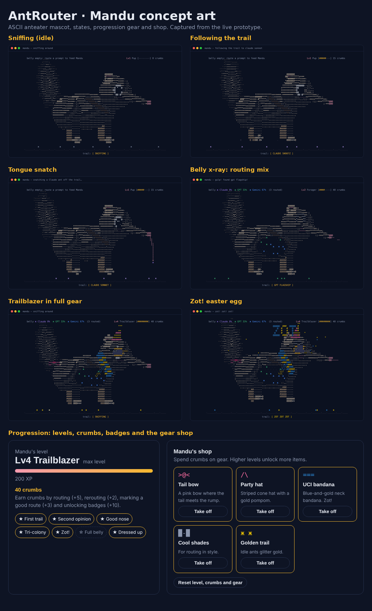

# AntRouter 🐜

**You bring the prompt. Mandu finds the trail.**

AntRouter is a model router for LLMs wrapped in a cozy companion game. You type the prompt you'd normally give an AI, and Mandu, an ASCII anteater, picks the best model among Claude, GPT and Gemini, shows you why, and learns from your corrections. Every prompt he routes becomes an ant in his see-through belly, so you can see where your prompts actually go.

Built as a course prototype at UC Irvine.



## Try it

- **Live prototype:** https://claude.ai/artifact/QukhYtx9aMp2BWc4KP9tMR
- **Run locally:** double-click `index.html`. No build step, no install, no API key.
- **Chrome extension:** open `chrome://extensions`, turn on **Developer mode**, click **Load unpacked** and pick this folder. Click the AntRouter icon in the toolbar to open Mandu in a popup. Progress in the popup is saved separately from the website.
- **Watch the loop:** press **▶ 1-minute tour** on the website, or play [`media/antrouter-1min-tour.mp4`](media/antrouter-1min-tour.mp4).

## What's in the prototype

| Mechanic | What happens |
|---|---|
| **Route** | Type or pick a prompt. A keyword router reads task type and difficulty and scores 7 models (Claude Opus/Sonnet/Haiku, GPT flagship/mini, Gemini Pro/Flash). |
| **Tongue snatch + belly** | Mandu follows the trail, snatches an ant in the model's color and swallows it. The belly x-ray shows your Claude / GPT / Gemini split. |
| **Reroute** | Disagree? Tap another model. Mandu tilts his head and that trail gets stronger for that task type. |
| **Good route** | Confirm a pick to reinforce it. |
| **Platform mode** | Tell Mandu which app you're in and he picks the right tier inside it. |
| **Hand off** | Opens the prompt in Claude or ChatGPT pre-filled. For Gemini, the prompt is copied to paste. |
| **Core loop strip** | Ask → Route → Reveal → Steer → Learn → Reward → Customize lights up as you play. |
| **Quests** | Three rotating goals that teach every mechanic and pay crumbs. |
| **Levels, badges, shop** | XP levels Mandu from Pup to Trailblazer. Crumbs buy a party hat, UCI bandana, shades, tail bow and golden trail. |
| **Care and play** | Pet him, let him nap, type `zot`, or use the terminal lights to expand, minimize or quit. |

Everything runs in the browser. Trails, belly, XP, crumbs and gear are saved in `localStorage`, so nothing leaves your machine.

## Repo layout

```
index.html                         the app page (website and extension popup)
manifest.json                      Chrome extension manifest (popup = index.html?popup)
css/app.css                        all styles, including the compact popup layout
src/models.js                      the 7 models, platforms and hand-off links
src/storage.js                     localStorage helpers (antrouter: keys)
src/router.js                      classify, score, learn from reroutes, explain (no page code)
src/game.js                        XP, crumbs, levels, quests, badges, shop
src/mandu.js                       Mandu's ASCII renderer and moods
src/result.js                      the result card
src/tour.js                        the 1-minute guided tour
src/app.js                         wires the page together: chat, tabs, panels
icons/, tools/make-icons.ps1       extension icons and the script that draws them
tests/                             node --test checks
versions/v1-before-progression/    earlier build, before belly ants, window buttons, levels and shop
docs/                              concept art, research, design spec and plan
media/antrouter-1min-tour.mp4      recording of the 1-minute guided tour
tools/record-tour.js               Playwright script that re-records the tour
```

## Working on the code

- Every file in `src/` adds itself to one shared object, `AntRouter` (for example `AntRouter.router`). Don't use `import`/`export`, because they break double-clicking `index.html`.
- Don't put `<script>` code or `onclick="…"` attributes in `index.html`. Chrome extensions block them, so put code in `src/` instead.
- `index.html` loads the scripts in order: models, storage, router, game, mandu, result, tour, app. A new file goes before the files that use it.
- **Tests:** with Node installed, run `node --test` from this folder.

## How the router works (prototype)

1. **Classify:** keyword patterns pick a task type (code, reasoning, creative, quick fact, summarizing, chat) and estimate difficulty.
2. **Score:** each model has illustrative quality, speed and cost ratings. Harder prompts weight quality more, easier ones favor fast, cheap models.
3. **Learn:** reroutes add +8 to the chosen model for that task type and −4 to the original pick. "Good route" adds +3.
4. **Platform filter:** in Claude, ChatGPT or Gemini mode, only that vendor's tiers are eligible.

Model ratings are placeholders, not live benchmarks.

## Roadmap

- Replace the keyword classifier with a small model (Claude Haiku or Gemini Flash)
- Real scores from LMArena and Artificial Analysis
- Prompt adapter that rewrites the prompt for the chosen model (see `docs/prompt-adapter-research.md`)
- Accounts and synced progress, then a Chrome extension that sits on top of ChatGPT, Claude and Gemini

## Publishing with GitHub Pages

Settings → Pages → Deploy from branch → `main` / root. The prototype is served at `https://<user>.github.io/<repo>/`.
